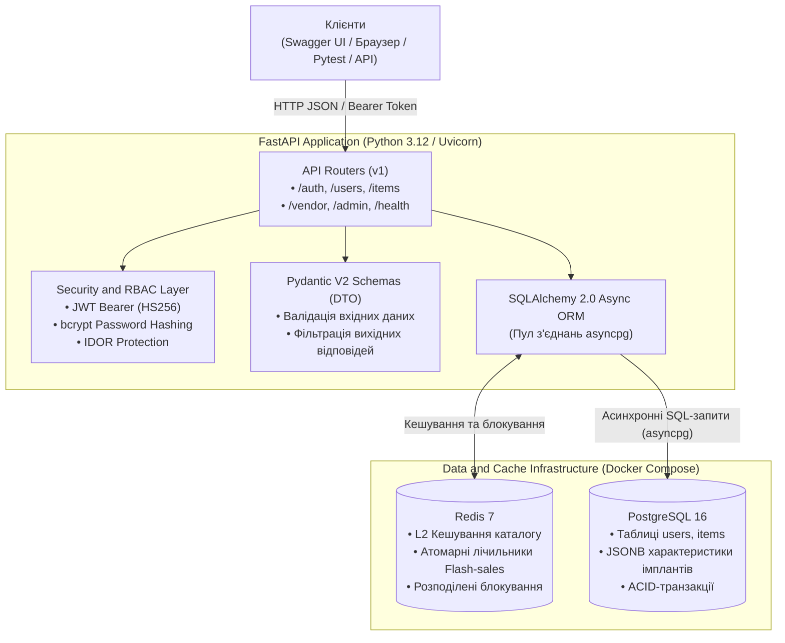
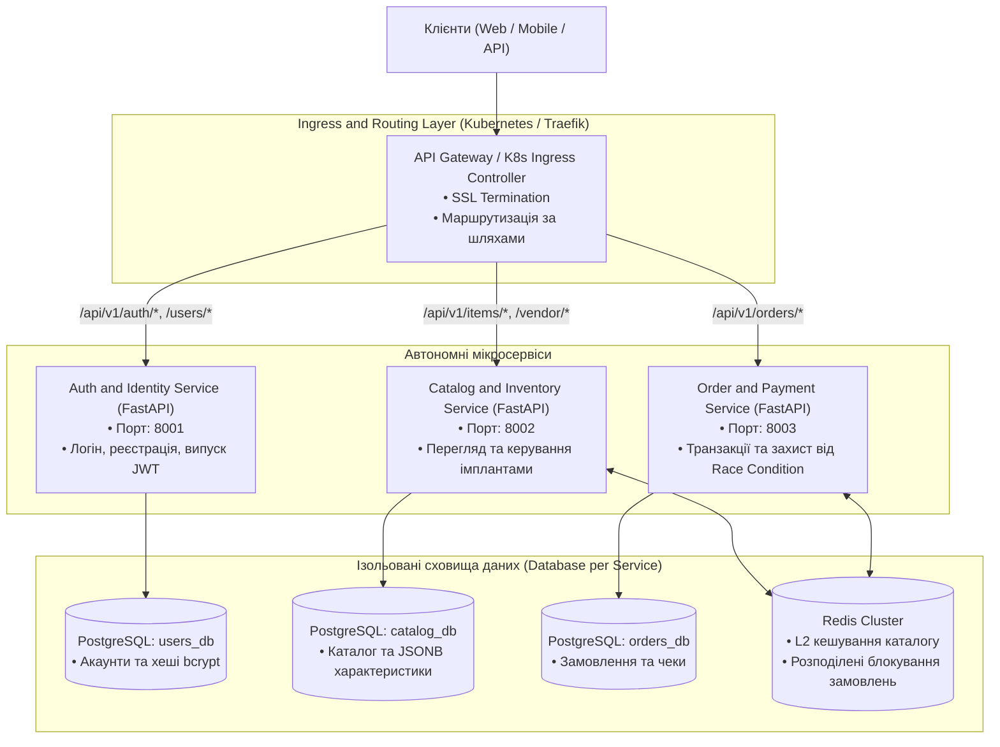
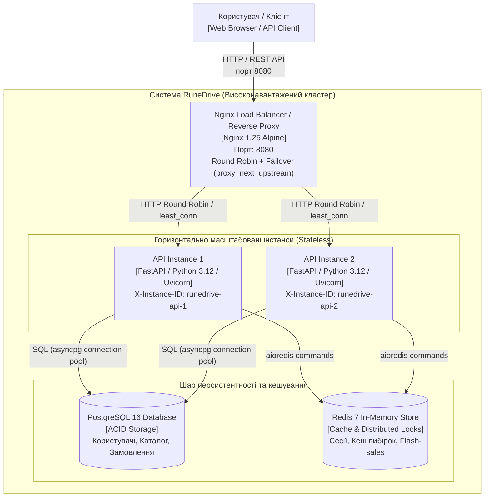

# Архітектурна специфікація системи «RuneDrive»

## 1. Загальний опис та обґрунтування предметної області
**RuneDrive** — це високонавантажена цифрова платформа (E-commerce / Digital Distribution), що спеціалізується на торгівлі кібернетичними імплантами, цифровими магічними рунами (прошивками) та алхімічними еліксирами у всесвіті Arcanepunk.

### Чому обрана ця предметна область для Highload-курсу:
1. **Екстремальні пікові навантаження (Flash Sales):** Рідкісні артефакти (наприклад, імплант «Кіроші Mk.3» або «Еліксир нескінченної мани») викидаються обмеженим тиражем (наприклад, 100 одиниць на 50 000 користувачів). Це ідеальний полігон для вивчення Race Condition, оптимістичних та песимістичних блокувань (`SELECT ... FOR UPDATE`), атомарних операцій у Redis (`DECR`, Lua-скрипти).
2. **Гетерогенні дані (JSONB):** Різні категорії товарів мають кардинально різні специфікації (імпланти потребують параметрів слотів, напруги та нейросумісності; зілля — час дії, об'єм та температуру). Використання PostgreSQL `JSONB` демонструє переваги комбінації реляційної надійності та документного NoSQL підходу.
3. **Розподіл I/O-bound та CPU-bound навантаження:**
   - **I/O-bound:** пошук за каталогом, фільтрація за характеристиками, транзакційна фіксація замовлень.
   - **CPU-bound:** валідація цифрових підписів токенів та рун, криптографічна перевірка ліцензій на прошивки.

---

## 2. Реальна архітектура системи (Mermaid)

---

## 3. Компоненти системи та їх відповідальність

| Компонент | Технологія | Роль у системі |
| :--- | :--- | :--- |
| **API Backend** | FastAPI (Python 3.12 + Uvicorn) | Асинхронна неблокуюча обробка HTTP-запитів (ASGI), маршрутизація, автоматична генерація OpenAPI / Swagger UI. |
| **Шар безпеки (Auth & RBAC)** | PyJWT + Passlib (bcrypt) | Stateless автентифікація за JWT-токенами, хешування паролів із сіллю, перевірка ролей (BUYER, RIPPERDOC, ADMIN) та захист від IDOR. |
| **Шар передачі даних (DTO)** | Pydantic V2 | Сувора типізація та валідація вхідних запитів, серіалізація та захист від витоку внутрішніх полів моделей. |
| **База даних (RDBMS)** | PostgreSQL 16 + asyncpg | Надійне транзакційне збереження даних користувачів та товарів, підтримка JSONB-специфікацій для гнучких характеристик артефактів. |
| **In-Memory сховище** | Redis 7 | L2-кешування вибірок каталогу для розвантаження бази, атомарні операції та розподілені блокування. |
| **Контроль якості та тести** | Pytest, Ruff, Pre-commit | Наскрізне асинхронне тестування бізнес-логіки та матриці доступу, лінтинг та форматування коду. |

---

## 4. Потенціал еволюції до мікросервісної архітектури (DevOps & Cloud Native)

Поточна кодова база спроєктована за принципом **модульного моноліту (Modular Monolith)** з чітким розділенням бізнес-доменів (Domain-Driven Design). Це створює прямий потенціал для швидкої декомпозиції системи на мікросервіси в межах дисципліни **«DevOps інфраструктура та хмарні технології» (викладач Дячук Р.Л.)**.

### 4.1. Чому RuneDrive легко декомпозується
1. **Stateless автентифікація (JWT HS256):** Токени містять усю необхідну інформацію (`sub: UUID`, `role: UserRole`, `exp`). Будь-який незалежний мікросервіс валідує криптографічний підпис токена локально за спільним `SECRET_KEY` без звернення до бази користувачів.
2. **Ізоляція доменів даних:** Сутності бази даних чітко розмежовані на користувачів (`users`), каталог товарів (`items`) та замовлення (`orders`).

### 4.2. Цільова мікросервісна архітектура (Mermaid)

### 4.3. Практична цінність для DevOps
* **Контейнеризація та Kubernetes (k8s):** Окремі маніфести `Deployment` та `Service` для кожного мікросервісу. Можливість налаштування `HorizontalPodAutoscaler (HPA)` окремо для Catalog Service (який отримує 90% трафіку читання) без надлишкового масштабування сервісу авторизації.
* **CI/CD пайплайни (GitHub Actions):** Налаштування незалежних матричних збірок (`matrix builds`) і умовного тестування: зміни в каталозі викликають збірку тільки Docker-образу `runedrive-catalog`.
* **Розподілений моніторинг (Prometheus / Grafana):** Збір персональних метрик (RPS, Latency p95/p99, Error Rate) з кожного мікросервісу через єдиний Ingress.
* **Інфраструктура як код (IaC / Terraform):** Опис хмарних ресурсів, мереж і сховищ окремо під кожен сервіс.

---

## 5. C4 Архітектурна діаграма контейнерів (C4 Container Diagram)

---

## 6. Аудит стану системи (State Audit Table — Лабораторна №2)

Для реалізації безстанової архітектури (Stateless Architecture) всі види стану системи було проаналізовано та винесено за межі процесів бекенду:

| Вид стану / Дані | Де зберігався б у Statefull | Де зберігається в RuneDrive (Stateless) | Механізм забезпечення консистентності |
| :--- | :--- | :--- | :--- |
| **Автентифікація користувача** | Сесія в пам'яті процесу (`memory dict` / `flask.session`) | **Stateless JWT токен** (клієнт надсилає в заголовку `Authorization: Bearer`) | Криптографічний підпис HS256 з перевіркою секретним ключем на будь-якому інстансі. |
| **Кошик та незавершені замовлення** | `request.session` на конкретному сервері | **PostgreSQL (таблиця `orders`, `order_items`)** + Redis кеш | Транзакційний запис у БД, доступний будь-якій репліці бекенду. |
| **Залишки товарів (Stock quantity)** | Локальні лічильники або змінні у пам'яті | **PostgreSQL (`SELECT ... FOR UPDATE`)** та атомарні оператори Redis (`DECR`) | Песимістичне блокування рядків у транзакції запобігає стану гонитви (Race Condition) при одночасних покупках. |
| **Кеш популярних позицій каталогу** | In-memory кеш Python (`@lru_cache`) | **Спільний Redis 7 екземпляр** | Усі репліки читають та інвалідують єдиний кеш у Redis. |
| **Файли та аватари (Assets)** | Локальна файлова система інстансу | **External Object Storage / спільний Volume** | Не прив'язано до контейнера. |

---

## 7. Аналіз потенційних вузьких місць (Bottleneck Analysis — Лабораторна №1)

1. **Пул з'єднань до бази даних (Database Connection Pool Exhaustion):**
   - *Проблема:* При горизонтальному зростанні кількості реплік API (`api-1`, `api-2`, ..., `api-N`) кожна репліка відкриває власний пул `asyncpg` (наприклад, по 20 з'єднань), що може перевищити `max_connections` у PostgreSQL.
   - *Рішення:* Використання PgBouncer (Connection Pooling Proxy) у режимі транзакційного пулінгу або обмеження розміру пулу на інстанс.
2. **Конкуренція за блокування залишків (Row Contention on Flash Sales):**
   - *Проблема:* Коли тисячі користувачів одночасно замовляють один популярний імплант, `SELECT ... FOR UPDATE` створює чергу очікування транзакцій у БД.
   - *Рішення:* Винесення пре-резервування залишків у Redis за допомогою Lua-скриптів (операція `DECRBY` атомарна і виконується за sub-millisecond).
3. **CPU-bound операції хешування паролів:**
   - *Проблема:* Алгоритм `bcrypt` навмисно ресурсомісткий (CPU-bound) для захисту від перебору. Масові одночасні запити на `/auth/login` можуть забити CPU ядра бекенду.
   - *Рішення:* Виділення окремих worker-процесів для автентифікації або перенесення сервісу авторизації на окремий пул інстансів.

---

## 8. Балансування навантаження та відмовостійкість (Лабораторна №3)

- **Точка входу:** Nginx працює як Reverse Proxy та балансувальник навантаження на порту `8080`.
- **Алгоритми розподілу:**
  - `Round Robin` (за замовчуванням): почерговий циклічний розподіл нових HTTP-запитів між `api-1` та `api-2`.
  - `Least Connections` (`least_conn`): спрямування запиту на бекенд з найменшою кількістю активних TCP-з'єднань (оптимально для важких запитів створення замовлень).
  - `IP Hash` (`ip_hash`): детерміноване закріплення клієнта за конкретним інстансом на основі хешу IP-адреси.
- **Failover (Resilience):**
  - Завдяки директиві Nginx `proxy_next_upstream error timeout invalid_header http_500 http_502 http_503 http_504`, у випадку раптової загибелі однієї репліки (`docker stop runedrive_api_1`) запит негайно передається працездатному інстансу без повернення клієнту помилок 5xx.
